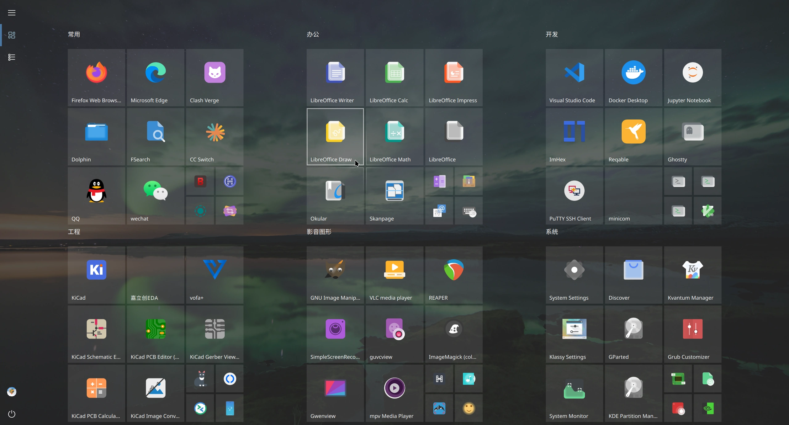
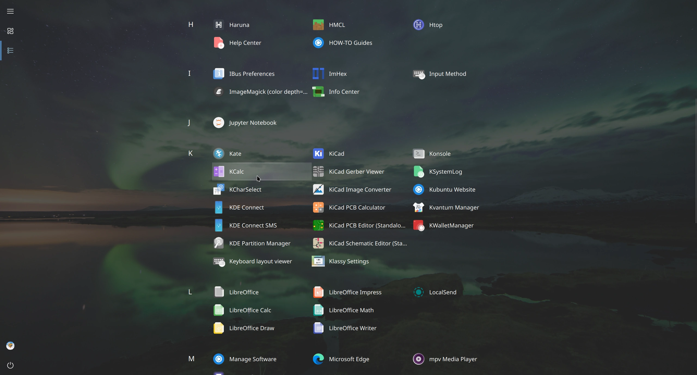
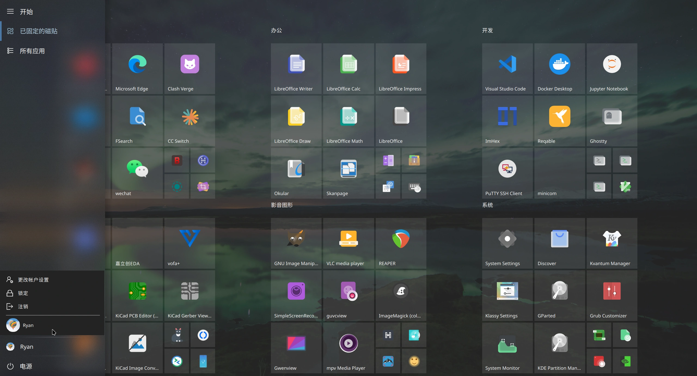

# MetroStart

A Windows 10 style tile Start menu for KDE Plasma 6, written as a Plasma applet.

It shows the Windows 10 pages - pinned tiles with group titles, the "all
applications" list, and the collapsible left rail with its power and user
flyouts - in a full screen overlay instead of the Plasma popup. The design is
reproduced from a reference capture; all machine specific data (applications,
icons, tile layout, wallpaper, avatar) comes from Plasma or from a configuration
file outside this repository.

Tested on **Plasma 6.6** / **Qt 6.10** (Wayland).

## Screenshots

The pinned page: 



The "all applications" page:


The left rail expanded:



## What works

Currently this project is a work in progress. Most of the functions has not been implemented yet, see below:

- [x] Static pages: the full screen tile grid and the "all applications" list
- [x] Basic UI motion: opening and closing the menu, switching between the two pages, the sidebar expanding on hover, hover highlights
- [x] Settings: the accent colour is configurable
- [x] Tiles dragging editing: basic drag and drop, but not full clone of the Windows 10 behaviour
- [ ] The remaining motion details
- [ ] Context menus
- [ ] A windowed (non full screen) Start menu
- [ ] Other display scales and resolutions

## Build and install

The applet is pure QML:

```bash
cmake -B build
cmake --install build --prefix ~/.local
```

The package is installed to
`~/.local/share/plasma/plasmoids/org.kde.plasma.metrostart`.

Then add **MetroStart** from *Add Widgets*. Nothing else in the system
configuration is touched; removing the applet is enough to undo it.

The menu stops above the panel and never covers it.

### Wallpaper and the sidebar

The menu paints the current desktop wallpaper itself and dims it, and the
sidebar blurs the content behind it in-app, which gives the acrylic look of the
reference. Neither uses a compositor effect, so the applet cannot affect other
windows and looks the same with compositor blur disabled.

## Layout file

Tiles are read from `~/.config/metrostart/layout.json`. The user owns the
arrangement - a column holds as many groups as they dragged into it - so the
file describes columns, and no group or column carries a position:

```json
{
  "version": 2,
  "columns": [
    {
      "groups": [
        {
          "title": "",
          "tiles": [
            { "app": "org.kde.dolphin.desktop", "size": "2x2" },
            { "app": "org.kde.konsole.desktop", "size": "1x1" },
            { "label": "KiCad", "icon": "kicad",
              "exec": "kicad", "size": "2x2" }
          ]
        }
      ]
    }
  ]
}
```

* `app` - desktop file name (menu id) from the application menu; its name and
  icon are used automatically.
* `label`, `icon` - optional overrides. `icon` may be an absolute path or an
  icon theme name.
* `size` - `1x1`, `2x2`, `4x2` or `4x4` (Windows 10 tile sizes).
* `col` / `row` - optional, pin a tile to an explicit cell inside the group.
* Tiles whose `app` is not installed are skipped.
* group `title` - shown above the group, empty by default.

Tiles are packed left to right, top to bottom inside a group; a group is as big
as its tiles, but never narrower than three 2x2 tiles (570 px). A column is as
wide as its widest group and the narrower groups keep the left edge. The
columns stand side by side with a 205 px gap, are centred in the fixed 2560 px
width, and each column stacks its groups 102 px apart (that gap holds the title
block of the lower group). The area grows downwards without a limit and
scrolls; it never gets wider.

Older layout files keep a flat `groups` list with an `x` (or a `column` index)
per group: those are grouped into columns on load, so the arrangement does not
change. Without a layout file the menu shows only the application list.

## Repository layout

```
package/contents/ui/
  main.qml          Plasma applet entry (panel button + full screen overlay)
  MetroMenu.qml     the menu surface; accepts an injected `context`
  TilesView.qml     groups and tiles
  AppListView.qml   the "all applications" list (sections, scroll, highlight)
  CapitalView.qml   letter grid shown after clicking the list's letter column
  RevealRect.qml    fill + interior glow + border, shared by every control
  RevealEdge.qml    one border edge with the radial pointer falloff
  RevealBorder.qml  the four edges of a control outline
  RevealGlow.qml    interior glow for the hovered control
  Sidebar.qml       left rail
  Flyout.qml        power / user flyouts
  Runtime.qml       live data: home, layout file, wallpaper, applications, user
  Avatar.qml        circular avatar (photo or fallback)
  AppIndex.qml      application menu enumeration (apps data engine)
  Layout.js         layout file -> group flow and pixel geometry
  Edit.js           editing primitives: ids, normalising, moving a tile
  Paths.js          XDG paths
  metrics.js        design constants
package/contents/assets/ui/   UI glyphs (hamburger, grid, list, power, clock, globe),
                              circle.frag.qsb (the avatar's circular cut)
docs/                         screenshots used by this README
```

`MetroMenu` takes a single `context` object so that a render harness can inject
its own applications, layout, icons, wallpaper and avatar while still using the
applet's rendering code.

The avatar's circular cut is a fragment shader: a mask item is applied as a
1-bit compare by the scene graph, which leaves the rim jagged at 30 px, while
the shader feathers the last pixel at any size. Rebuild the shader after
editing `circle.frag` with the Qt Shader Tools:

```bash
qsb --qt6 -o circle.frag.qsb circle.frag
```

## Licence

GPL-2.0-or-later.
